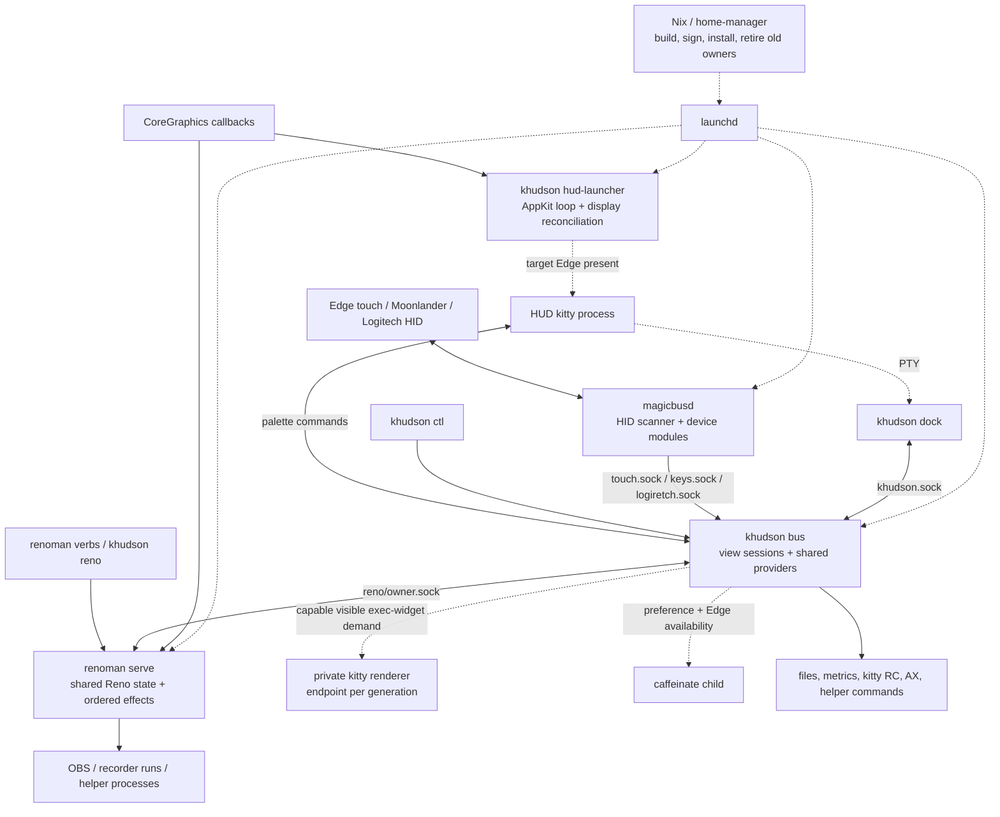
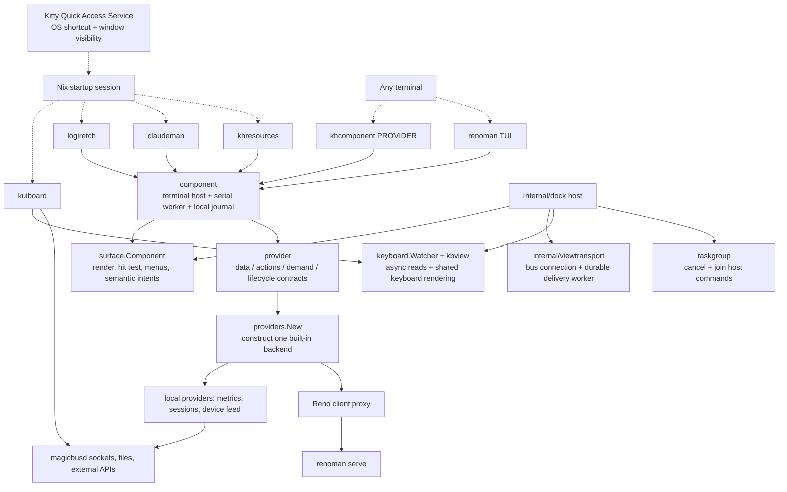
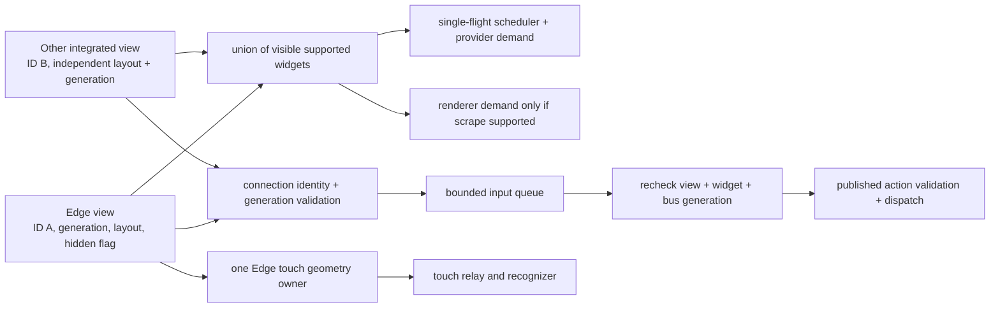
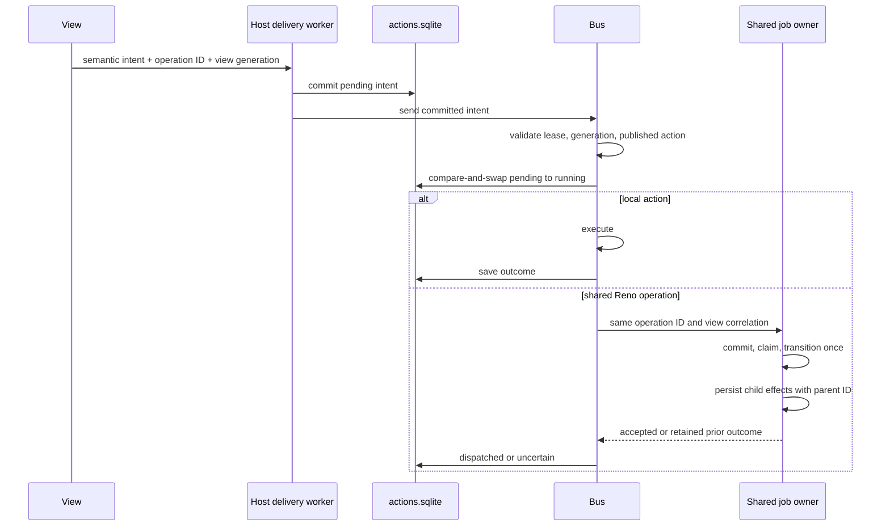

# khudson architecture

This describes the working tree after the October 7 ecosystem review. The user's
21:19 EDT apply installed the prior standalone/service implementation. Changes
from this review still require an apply. Native startup and heartbeat were
observed with the Edge absent; neither observation establishes the freeze's
cause. See [runtime evidence and test limits](display-conformance.md).

A "dock" in the wire protocol is a terminal UI client. It is not a hardware dock,
monitor, or kitty process. Kitty hosts the UI and owns the Quick Access shortcut.
Physical display presence, client connection, visible view demand, and background
job ownership have separate lifetimes.

## Processes and resource owners

Ownership is implemented in [agent definitions](../nix/module.nix),
[magicbus activation](../nix/magicbus.nix),
[bus startup](../khudson/internal/bus/bus.go),
[renderer lifecycle](../khudson/internal/bus/renderer.go),
[Reno service](../khudson/internal/renoservice/service.go), and
[HUD child lifecycle](../khudson/internal/hudlaunch/hudlaunch.go).

The bus and Reno each hold an exclusive file lock before claiming sockets,
recovering journals, or constructing stateful backends. Locks remain held through
worker shutdown. A second starter cannot construct another backend. Activation retires the old bus and Reno process before replacement
bootstrap, because the old bus used to own Reno. The HUD owner is retired as well.
Replacement services are checked without force-restarting them a second time.
Magicbus uses the same retirement helper when its binary, config, or plist changes;
failed replacement preserves its retry markers. This costs a service interruption
during apply and fails activation if a former owner does not exit in time.
[Owner acquisition](../khudson/internal/renoservice/service.go),
[activation migration](../nix/module.nix).

## Reusable packages and standalone programs

The public packages are `provider` (its Go package name is `module`), `providers`,
`surface`, and `component`. `surface` has injected connection and URL-opening
interfaces; it does not implement socket dialing or start the integration bus.
The Nix dependency check rejects any standalone entrypoint that imports
`internal/bus`, `internal/dock`, or `internal/viewtransport` transitively.
[Contracts](../khudson/provider/module.go),
[catalog](../khudson/providers/providers.go),
[composition](../khudson/surface/component.go),
[integrated adapter](../khudson/internal/dock/dock.go),
[dependency check](../../../../../lib/mkchecks.nix).

| Program | Function and dependency |
| --- | --- |
| `kuiboard` | Keyboard viewer, passive key feed, asynchronous identity/layout/update reads, separate firmware worker. |
| `logiretch` | Logitech viewer using the shared passive provider. |
| `claudeman` | Claude session panel and actions using the shared Claude control package. |
| `khresources` | Resource composition over CPU, disk, and process providers. |
| `renoman` | Recorder TUI and CLI, using the shared Reno owner. `serve` runs that owner. |
| `khcomponent NAME` | Standalone host for each built-in provider; `--list` enumerates names, `--params` supplies its JSON parameters. |

Entry points: [keyboard](../khudson/cmd/kuiboard/main.go),
[Logitech](../khudson/cmd/logiretch/main.go),
[Claude](../khudson/cmd/claudeman/main.go),
[resources](../khudson/cmd/khresources/main.go),
[Reno](../khudson/cmd/renoman/main.go),
[catalog host](../khudson/cmd/khcomponent/main.go).

The built-in catalog includes brightness, cheatsheets, Claude sessions/panel,
CPU/memory, demo mode, disk, Dock mirror, GitHub PRs, kitty sessions, Logitech,
media, processes, resources, sysmon, and Reno. Construction is lazy. Reno's
constructor in this catalog constructs a client, not another state owner.
[Catalog implementation](../khudson/providers/providers.go).

Quick Access launches four component windows and a shell tab. It keeps remote
control disabled. Kitty's Service owns the global shortcut; none of these
programs adds a global hotkey listener. DEC 2033 reports drive view visibility,
not focus. Unsupported terminals retain their configured bounded polling.
[Nix session](../nix/module.nix),
[visibility adapter](../khudson/internal/visibility/visibility.go),
[Kitty Quick Access documentation](https://sw.kovidgoyal.net/kitty/kittens/quick-access-terminal/),
[visibility protocol](https://rockorager.dev/misc/visibility-reports/).

## Integrated view sessions and demand

Protocol v2 gives each connection a random view identity and generation. Layout
navigation changes that view; explicit global CLI layout changes still change
all views. Hiding, showing, navigation, configuration replacement, renderer
replacement, and disconnect retire old action eligibility. A second view cannot
borrow the first view's lease. The bus checks widget membership in that view's
layout as well as the published action allowlist.
[Sessions and validation](../khudson/internal/bus/views.go),
[action execution](../khudson/internal/bus/input.go).

Legacy protocol-0 clients are read-only native-state consumers. Protocol-1 clients
must reconnect using the new package. The UI advertises home and keyboard layouts,
without scraped-frame capability. The configured full-panel exec view remains
unsupported; the bus refuses it and starts no renderer for it. This is a visible
capability limitation, not a completed exec-frame UI.
[Negotiation](../khudson/internal/bus/capabilities.go),
[client hello](../khudson/surface/host.go).

| Demand | Owner behavior |
| --- | --- |
| No integrated visible widgets | Scheduler retains its cheap tick; no presentation provider polls or renderer starts. |
| Visible Edge view | Touch feed is demanded; one assigned Edge connection receives gestures. |
| Visible keyboard layout or kb-live widget | Bus key feed is demanded. |
| Any visible integrated view | Battery feed is demanded for the status strip. |
| Hidden standalone view | Cancel current poll, withdraw demand, stop timer, reject retired results/actions. Showing requires a fresh snapshot before accepting actions. |
| No keyboard presentation | Cancel identity/layout/update reads. Passive key events remain available to the standalone viewer. |
| No Reno clients | Owner retains state and job execution; no display polling runs on its own. |
| No Edge client | Caffeinate pauses despite retained preference. Theme intent persists; physical palette/brightness work waits. |

[Demand union and relays](../khudson/internal/bus/views.go),
[relay shutdown](../khudson/internal/bus/relays.go),
[standalone worker](../khudson/component/engine.go),
[keyboard watcher](../khudson/internal/keyboard/watcher.go),
[Reno request-driven polls](../khudson/internal/renoservice/service.go),
[caffeinate availability](../khudson/internal/bus/caffeinate.go),
[theme persistence](../khudson/internal/bus/themestate.go).

Physical Edge ownership is separate from visibility: a hidden Edge client keeps
its geometry reservation and Edge availability, but receives no gestures while
hidden. The hardware daemon continues enabled device services independently;
keyboard and mouse functionality must remain useful without an Edge display.
[Active-client routing](../khudson/internal/bus/bus.go),
[device module runner](../touchd/module.go).

## Durable intent and independent jobs

The integrated view commits to the same SQLite journal as the bus, off the UI
thread and before sending. Submission to the preceding in-memory queue is not a
durability acknowledgement; exit before commit can lose that unaccepted intent.
Committed pending work survives transport failure and is inspectable. On restart,
transient pending input is discarded, interrupted side effects become uncertain,
and only whitelisted absolute desired-state commands may reconcile. Raw pointer
motion is not persisted or replayed. Operation-ID deduplication lasts only as
long as retained history.
[Delivery boundary](../khudson/internal/viewtransport/connection.go),
[journal](../khudson/internal/actionjournal/journal.go),
[bus recovery](../khudson/internal/bus/actions.go).

Standalone components use a local journal and one action-capable owner per state
directory. `--actions` inspects records and `--discard-action ID` acknowledges
uncertain work. Reno uses its own service journal; `renoman jobs [after-sequence]` and
`renoman discard-job ID` inspect/acknowledge it. Bus inspection uses
`khudson ctl actions [after-sequence]`. These wire responses contain `records`
and an optional `next` cursor, with at most 128 records and 1 MiB per page;
pass `next` to fetch the following page. Payloads are retained in full. Lost acknowledgements never
trigger automatic action replay. Parent operation, view ID, and generation are
retained in child-effect records and diagnostics.
[Component host](../khudson/component/component.go),
[component CLI](../khudson/component/cli.go),
[Reno service](../khudson/internal/renoservice/service.go),
[effect runner](../khudson/internal/effectrun/effects.go).

Firmware flashing runs in a detached `kuiboard --flash-worker ID` process with an
exclusive job lock and durable job record. Closing or hiding its TUI does not
cancel an accepted flash. The worker owns execution, verification, and final
outcome. An abandoned or failed job becomes uncertain and is never reflashed
automatically. `kuiboard --flash-status` inspects it; `--discard-flash ID`
acknowledges uncertainty. Progress is bounded and separate from the state machine.
[Firmware owner](../khudson/internal/keyboard/flashjob/job.go),
[worker entrypoint](../khudson/cmd/kuiboard/main.go).

## Display callbacks, errors, and evidence

The HUD launcher runs an AppKit event loop on the initial locked OS thread.
Registration/removal results are checked. Completed callbacks invalidate cached
state; failed reconciliation retains pending work and retries without requiring
another event. Registered operation retains a slow reconciliation fallback.
Reno uses the same callback adapter with a demand-driven cache: at most one
normal topology query per minute absent invalidation, or two-second fallback
when registration is unavailable. Failed queries retain invalidation and back
off from one to 32 seconds. Native calls cannot be forcibly canceled by Go context.
[HUD application owner](../khudson/internal/hudlaunch/application.go),
[callback adapter](../khudson/internal/cgdisplay/notifications.go),
[Reno display cache](../khudson/internal/cgdisplay/cache.go),
[Apple lifecycle and limits](display-conformance.md#apple-contract-and-evidence-limits).

Boundary records retain error kind, native code when available, occurrence count,
selected recovery action, process identity, and operation correlation. Logs are
rotated under a shared nonblocking lock. Contention drops a write; the next
successful append records the number lost. Joined failures retain each code.
Input observation separates key, click, and motion counters; it records no input
contents. These counters do not prove delivery to
an application. Unknown errors stay unknown instead of being renamed as TCC or
WindowServer failures.
[Diagnostics](../khudson/internal/diagnostic/diagnostic.go),
[bounded files](../khudson/internal/diagnostic/file.go),
[input observations](../touchd/inputdiagnostics.go).

The fake-boundary harness validates application lifecycle and recovery policy
without hotplugging displays, posting input, opening HID devices, or flashing
firmware. Natural hotplug callback delivery, installed Quick Access visibility
reports, permissions for the separately signed Reno owner, and the original
freeze's causal mechanism remain native observations, not claims made by these
tests. See [conformance scenarios and artifacts](display-conformance.md).

## Bounds and shutdown guarantees

- NDJSON frames are limited to 8 MiB; each asynchronous writer retains at most
  16 MiB across queued and in-flight payloads, subject also to its message-count
  limit. Oversize or backpressure closes the connection. Serialization itself
  uses a temporary allocation. [Transport](../khudson/internal/socketio/writer.go),
  [decoder](../khudson/internal/socketio/decoder.go).
- Failed standalone polls back off to 30 seconds (or a slower configured cadence).
  Successful polls restore their normal cadence.
- Provider subprocesses have a five-second ceiling, bounded stdout/stderr,
  process-group cancellation, and a pipe-drain deadline. This may reject unusually
  large or slow queries. [Subprocess boundary](../khudson/internal/subprocess/output.go).
- AX setup checks the timeout-setting result and retries failed setup. Native
  error codes survive wrapping; partial multi-process actions remain errors.
  A Go deadline cannot interrupt a native AX call already in progress.
  [AX adapter](../khudson/internal/ax/ax.go), [focus/visibility](../khudson/internal/ax/focus.go).
- The Reno service closes its backend after clients and effects have joined,
  retaining its owner lock and journal through backend cleanup. Polls inherit
  request deadlines and connection cancellation; expired polls do not wait
  behind another poll. These cancellations cannot interrupt a native call
  already in progress.
- Reno closes and joins watchdogs, active effect drivers, and retiring drivers.
  A replacement waits for the previous driver's restoration/exit, adding latency
  during level changes. Interrupted commands remain uncertain for review.
  [Driver lifecycle](../khudson/internal/module/reno/sustain.go),
  [execution outcomes](../khudson/internal/actionjournal/outcome.go).
- The hardware broadcaster joins idle readers/writers, limits clients to 64,
  and disconnects lagging consumers rather than losing input-release frames.
  Reconnection costs a brief gap but clears stale held-key state.
  [Broadcaster](../touchd/broadcast.go), [key consumer](../khudson/internal/keyfeed/feed.go).
- Cached layouts, recorder state, firmware archives, and launcher backoff use
  private temporary files and atomic replacement with filesystem sync. SQLite
  remains the acceptance/outcome journal. [File publication](../khudson/internal/atomicfile/write.go).

Restart reconciliation discards an older desired-state request when a newer
choice for the same global setting supersedes it. Journal pruning retains the
successful successor needed to prove this while older reconciliation remains
unresolved. Global desired-state controls serialize acceptance through outcome
so execution and journal order agree. This can delay another mutating control;
read-only inspection does not acquire that lock. Layout writes hold a separate
lock, leaving bus state accessible during filesystem sync; config and view
capabilities are revalidated before publication. A failure after file publication,
an unsaved final control outcome, or a lost remote acknowledgement returns
uncertainty.
[Recovery and controls](../khudson/internal/bus/actions.go),
[retention](../khudson/internal/actionjournal/journal.go).

A saved theme remains the desired theme when kitty rejects the update or its
palette cannot be read. Its application stays pending until another Edge adoption
or an explicit theme command reconciles it. This can leave the semantic theme
visible while the host palette is still catching up.
[Theme reconciliation](../khudson/internal/bus/theme.go).

Reno responses preserve committed operation state even when response encoding
fails. Clients validate response type and operation ID. Lost mutation replies and
failed effect admission after a provider transition retain uncertainty, preventing
a failed acknowledgement from authorizing a repeated transition. Explicit journal
discards and storage/read failures emit boundary records.
[Service protocol](../khudson/internal/renoservice/service.go),
[effect admission](../khudson/internal/effectrun/effects.go).
