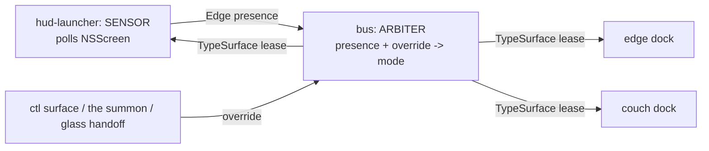

# khudson panel surfaces -- edge + couch (design + arc)

status: proposed, reconciled 2026-08-19. grounded in kitty 0.48.2's shipped docs/plists/kitten sources, upstream v0.48.2 C and Go source, and the khudson tree; NOTHING run on glass -- phase 0 exists to fix that. reviewed by three same-model design lenses (feasibility, ordering, hermeticity), one cross-model wedge review (codex), and one different-model wedge review (fable); every load-bearing claim relayed from a reviewer was re-verified here against source before landing in this doc. companions: standalone-modules-design.md (couch doctrine), DESIGN.md (fullscreen + launch), ecosystem.html (topology).

## the reframe

quick-access-terminal is not a separate mechanism. it IS the panel kitten with a toggle preset and its own conf file (kittens/quick_access_terminal/main.go builds the panel argv and execs it). so "QAT for edge and couch" resolves to: BOTH surfaces become panels, and only the couch one takes the QAT preset, because only it wants toggle semantics.

the edge one must NOT be QAT: the service binary passes `--move-to-active-monitor` (strings-verified), right for a drop-down and fatal for a display-pinned HUD.

| | khudson-edge | khudson-couch |
|---|---|---|
| invocation | `kitten panel`, supervised by khudson | the existing macOS Service (ctrl+opt+shift+K) |
| instance group | khudson-edge | khudson-couch (khudson's own service, not kitty's) |
| edge | center | top (or center) |
| output_name | "XENEON EDGE" | unset (follows active display) |
| physical screen frame | yes (covers menu bar + Dock) | no |
| focus_policy | not-allowed | not-allowed |
| layer | overlay (or tuned via macos_ns_window_layer) | overlay |
| lifecycle | shown while the Edge is present AND edge mode is active | start_as_hidden, toggled by the Service |
| payload | `khudson dock` | `khudson dock` under a couch config |
| conf | generated hud conf | generated conf, reached by one `include` |
| RC socket | kitty-panel.sock (fixed, CLI-bound) | no fixed path; reports KITTY_LISTEN_ON at hello |

USER DECISION 2026-08-18: the surfaces are MUTUALLY EXCLUSIVE -- exactly one dock is active at a time. this supersedes the first cut of this doc, which argued they should be independent. exclusivity is what makes the bus's existing singleton state (config, layout, grid, recognizer calibration) CORRECT rather than a multiplexing bug, and it removes per-dock state from the critical path.

## surface arbitration

ONE word for the concept, end to end: SURFACE. the requested value is `Surface: auto | edge | couch`; what it resolved to is `ActiveSurface: edge | couch | none`. `auto` means Edge presence decides. (naming note: `auto` is a policy rather than a surface, which argues for calling the field `mode` -- but `mode` collides with theme, demo-mode and caffeinate, and `caffeinate on|off|toggle` already sets the precedent that this CLI's value slot holds instructions as well as states. one word beats a precise-but-ugly `surface-mode`.) the override exists for dev, demo and testing (USER REQUEST 2026-08-18): force couch while the Edge is connected.

dataflow -- one arbiter, three consumers, no component acting on private knowledge:



hud-launcher is the sensor because NSScreen presence is its knowledge and nobody else's; it stops acting on it unilaterally. the bus is the arbiter because it is the hub every dock already talks to and it already broadcasts exactly this shape of state (config, layout, theme, caffeinate). everyone subscribes, INCLUDING hud-launcher -- the gap the first cut had was inventing this concept and plumbing it to one component.

three access routes to the override: `khudson ctl surface auto|edge|couch`; the summon itself (pressing ctrl+opt+shift+K while docked IS the intent, so it forces couch -- no second binding, nothing to remember); and an on-glass handoff affordance (strip tab or long-press item) so the Edge can push khudson to the laptop without a keyboard. the third rides whenever the overlay vocabulary is next open -- once TypeSurface exists it is another caller of the same setter.

### what the protocol actually needs (from the codex review, verified)

client-side placarding CANNOT enforce exclusivity. today gestures broadcast to every dock (bus.go:783) and inbound actions lose connection identity entering the shared input queue (bus.go:402), so a parked-but-stale dock still causes effects while the bus believes another surface is active. and the greeting replays config, layout, theme and cached data but has no mode field (bus.go:321), so a mode broadcast sent before a dock connects is simply lost. the proto has no surface id, role, mode, or epoch at all (proto.go:14, :59).

so arbitration needs, minimally:
- every connection declares an immutable SURFACE ID and ROLE in hello (dock-edge, dock-couch, launcher).
- readiness reported independently of active state.
- the bus issues a monotonic ACTIVE LEASE `{surface, epoch, expiry}`, and filters BOTH outbound gestures and inbound actions by identity and current epoch.
- every greeting replays desired mode, current active surface, epoch, presence.
- `setGrid`/`setPanel` gate on the ACTIVE dock (bus.go:313-314, :379-381). without this, a parked dock reconnecting after a KeepAlive relaunch stomps the active dock's grid and resizes every scrape window -- indistinguishable from a wedge.

### defaults (provisional, not locked)

- forced mode resets to `auto` when the bus restarts. KEEP: it bounds bad mode state to one bus lifetime and makes `kickstart -k` on the bus a universal unwedge lever. persisting it (like layout.state does, bus.go:247-267) creates the forgotten-sticky-override: forced-couch surviving days, Edge replugged, placard "mysteriously" forever.
- hud-launcher falls back to presence-only after a bounded grace if the bus goes quiet. KEEP: it breaks the only launcher/bus cycle the proposal can create.
- these two are only safe TOGETHER. the fallback target (presence = edge) equals the post-restart arbitration result (auto = edge), so a crash-looping bus CONVERGES. persisted mode + presence fallback is a flapping loop by construction: the fallback says edge, each bus recovery says couch, repeat.
- sharpening: measure the grace from the last mode MESSAGE, not from TCP disconnect -- a connected-but-mute bus must trip it too. the launcher's bus role needs its own liveness contract, since the bus reaps silent dock roles at 3x heartbeat (bus.go:367-374).

## what changed upstream

kitty 0.48.0 landed 2026-07-18; we run 0.48.2 for both the daily kitty and the khudson.app copy.

- `macos_use_physical_screen_frame`: panel placement uses `screen.frame` instead of `visibleFrame` and zeroes the menubar inset (cocoa_window.m:2754-2757). the option whose absence killed the panel HUD -- the 2026-07-03 menubar patch existed only to delete that subtraction.
- `macos_ns_window_layer`: NSWindow level from an integer, an AppKit/CoreGraphics constant, or arithmetic. applied to panels via glfw.c:186 and to normal windows at creation via glfw.c:1997 (docs say panel-only; the code is broader).
- `acceptsFirstMouse` now unconditionally YES (cocoa_window.m:1016, PR 10233). the old first-tap-swallow patch is dead.

## why the edge migration is the bigger prize

**panels self-heal on display reconfiguration.** every GLFWWindow registers for `NSApplicationDidChangeScreenParametersNotification`, and the handler re-applies the layer-shell config -- panels only, normal windows take an early return (cocoa_window.m:2265-2268). re-applying re-runs `screen_for_name(output_name)` and `setFrame`. that is the arrangement-staleness tracking hudlaunch hand-rolls today (hudlaunch.go:1-13).

**the RC risk evaporates on inspection.** the 2026-07-03 panel restrictions do not bite: the bus's ONLY line to kitty-panel.sock is get-colors/set-colors (bus/theme.go:44), and the HUD kitty is never dialed for window ids (bus.go:136). every scrape/launch/resize verb targets the substrate.

**the rest of the ledger:**
- `--position`/`LaunchPos` math deleted outright -- `output_name` pins by display name.
- no native fullscreen means no fullscreen Space, retiring the "fullscreen Space lifecycle on replug" open item.
- panels get `CanJoinAllSpaces | Stationary | IgnoresCycle` (cocoa_window.m:2814).
- `focus_policy=not-allowed` makes `canBecomeKeyWindow` return NO (cocoa_window.m:2300) while `acceptsFirstMouse` stays YES: clicks land, keyboard focus never does. the Moonlander-collision resolution standalone-modules-design.md:32-34 demands, enforced by the host on BOTH surfaces.
- the panel kitten FORCE-adds `macos_hide_from_tasks=yes`, `macos_quit_when_last_window_closed=yes`, `macos_window_resizable=no` to every panel instance. hide-from-tasks is the floor, not an opt-in.

## what does not change

- **display-presence gating stays.** `screen_for_name` falls back to `screen_for_window_center` when the name is absent (cocoa_window.m:2743-2745), so a launch with the Edge unplugged still lands the panel somewhere. the launcher shrinks; it does not disappear.
- **the substrate stays a separate regular instance.** panel instances never paint invisible windows (module.nix:200, burned 2026-07-03).
- **the three-process topology stays** (hud / substrate / bus).

## what breaks, or needs eyes

- **grid geometry.** 196x24 is tuned to the pixel (`modify_font cell_height 1px` + `placement_strategy top-left`). the EDGE_CENTER branch sets `height = NSHeight(screen.frame) - menubar_height + 1` (cocoa_window.m:2758), so with a physical frame the panel is 721px tall. 24 rows still fit at 30px cells; the gutter math needs re-measuring.
- **`constrainFrameRect:toScreen:` is NOT suppressed for panels.** the override exists (cocoa_window.m:2288) but `suppress_frame_constraints` is set only during traditional-fullscreen restore (cocoa_window.m:820). the 2026-07-03 regression was exactly this. phase 0 question, not an assumption.
- **unplug parks an overlay panel on the laptop.** on Edge loss the panel re-places to the fallback screen: overlay layer, physical-frame sized, accepts clicks, refuses focus, hidden from tasks. the launcher notices only on its healthy tick (default 4 x 15s = 60s, hudlaunch.go:83-89). phase 0 must resolve "what does a panel do while the Edge is absent" to "the launcher hides or kills it", never "trust the fallback placement". consider event-driven presence -- internal/cgdisplay already links CGDisplay and a reconfigure callback is one more C shim.
- **`hide_on_focus_loss` and `focus_policy=not-allowed` are mutually exclusive.** kitty forces focus to on-demand whenever auto-hide is set (kittens/panel/main.py). the current QAT conf sets `hide_on_focus_loss = "yes"`, so keeping it silently reinstates keyboard focus and the Moonlander collision. decidable at eval -- it gets an assertion, not a glass surprise.

## the summon (couch only)

USER DECISION 2026-08-18: khudson IS the quick-access terminal on this machine. no second Service, no second bundle, no second instance group; the existing binding summons khudson, and the daily terminal config is GUTTED, not migrated.

**the binding.** verified: `defaults read pbs NSServicesStatus` holds exactly one entry, `net.kovidgoyal.kitty-quick-access - Quick access to kitty - quickAccessTerminal`, `key_equivalent = "~^$k"`. the service lives in kitty's nested LSBackgroundOnly bundle `kitty.app/Contents/kitty-quick-access.app`; its binary execs the sibling `kitten` with `panel --single-instance --instance-group ... --toggle-visibility --move-to-active-monitor`. the shortcut is only that plist string, so flags cannot ride on it -- everything configurable comes from the conf.

**nix owns the binding, colocated with kitty.** darwin-specific and kitty-specific, so it belongs in home/kitty/default.nix beside `quickAccessTerminalConfig` -- home-manager, not nix-darwin:

```nix
targets.darwin.defaults."pbs".NSServicesStatus = {
  "net.kovidgoyal.kitty-quick-access - Quick access to kitty - quickAccessTerminal" = {
    key_equivalent = "~^$k";   # ~ opt, ^ ctrl, $ shift, @ cmd
  };
};
```

probe-verified 2026-08-18 on a throwaway domain: `defaults import` MERGES at the top level, so the other pbs keys here (`FinderActive`, `FinderOrdering`, `ServicesShortcutsPresent`) survive; the `NSServicesStatus` dict itself is replaced wholesale, which is the intent. home-manager applies it from `home.activation.setDarwinDefaults` and carries its own darwin platform assertion.

**the provider is NOT nix-controlled today.** `lsregister -dump` registers `net.kovidgoyal.kitty-quick-access` at exactly one path: the `/nix/store` bundle. the home-manager copy under ~/Applications is registered, but LS has no record of its nested quick-access bundle. that store path survives only because nix-gc holds back dead paths containing `.app` dirs (modules/darwin/nix-gc.nix:53-59) -- an App-Management-TCC workaround, not a declared root. so phase 2's exit criterion is a READBACK, not just a write: after the pbs write and flush, assert the declared key is present AND that the provider resolves to a path nix controls.

**the payload is a session, not a program.** the conf CAN express what runs: `kitty_conf` -> a kitty conf with `startup_session` -> a session file, kitty's own vocabulary for tabs, splits, layouts, cwds and programs. precedence verified (kitty/session.py:349): a session applies when no cmdline argv was given; argv wins when there is one. couch is Service-invoked with no argv, so it takes a session. edge passes `khudson dock` as argv and ignores sessions -- it can move to one if the two-zone contract is ever expressed declaratively instead of by RC.

**the conf lands as one `include`, not more attrs.** `quickAccessTerminalConfig` is typed `attrsOf` a SCALAR, and khudson's module already defines `quickAccessTerminalConfig.kitty_override` (module.nix:536), so a second definition is an eval conflict -- and kitty's `kitty_conf`/`kitty_override` are multi-value options that cannot be expressed as repeated attrs anyway. the seam is kitty's own `include`: one scalar key pointing at a generated store conf carrying as many lines as the surface wants. the include path must come from a `writeText` derivation, because kitty swallows a missing include silently.

**the couch surface has no fixed RC socket, and that is fine.** the QAT kitten never forwards `--listen-on` (its Go argv build has no such flag), so any `listen_on` arrives as config -- and `expand_listen_on` appends `-{kitty_pid}` for unix paths and rewrites tcp ports to 0, both only when `from_config_file` (main.py:405-410, :484-487). kitty deliberately denies predictable endpoints from config. the escape is the mechanism kitty provides: `KITTY_LISTEN_ON` is exported to the child (child.py, boss.py), so the couch dock reads its own endpoint and reports it at hello. the bus learns the path instead of assuming it. correction to an earlier claim in this doc: the couch surface CAN do RC and CAN bind a socket; only the PREDICTABILITY is denied.

**bundle identity: khudson owns the provider.** USER DECISION 2026-08-19: the couch surface wears khudson's face -- after this migration everything downstream IS khudson, so khudson owns the service bundle rather than borrowing kitty's.

as things stand it would not: `GetQuickAccessKittyExe` prefers `<bundle>/Contents/kitty-quick-access.app/Contents/MacOS/kitty-quick-access` when executable (kittens/panel/main.go:35-46), and hud-app.nix:73 deletes exactly that sub-bundle from khudson.app while :89 strips `NSServices` from the Info.plist. so the couch panel would re-exec into kitty's store bundle and appear as kitty in permission prompts, Privacy panes and Login Items.

both of those lines reverse. hud-app.nix KEEPS the nested quick-access bundle, rebrands it (own bundle id, own display name, khudson icns) and gives it an `NSServices` entry of its own; the couch panel then resolves its exe inside khudson.app and the whole chain -- service provider, panel process, dock payload -- carries khudson identity.

three consequences worth naming:
- the SHORTCUT is unchanged (ctrl+opt+shift+K); what changes is the service it names. nix declares `NSServicesStatus` wholesale, so binding khudson's service key means kitty's entry simply goes unbound -- exactly one summon, and it is ours.
- a DISTINCT bundle id sidesteps the LaunchServices tiebreak entirely. the hermeticity review proposed registering the home-manager copy of kitty.app, which would have put two providers with the same id in the LS database and made the winner LS's call rather than nix's. a separate identity has no competitor.
- it closes the provider hole: the summon stops depending on a `/nix/store` path retained only by the gc's `.app` holdback.

### can khudson intercept the keys itself?

a note, not a plan -- the Services route is the trigger. detect yes, swallow no.

- touchd opens the Moonlander's raw-HID vendor channel (interface 1, usage page 0xFF60) and streams per-key MATRIX events on keys.sock: passive, focus-independent, no seize. khudson already sees every press on that board wherever focus is.
- it cannot consume one. that feed runs ALONGSIDE the normal keyboard path. swallowing needs a CGEventTap (new Accessibility grant, a global hook in the path of every keystroke) or seizing the keyboard collection (stops the board typing). not worth it for a summon.
- if a chord trigger is ever wanted: matrix events key on physical POSITION, so a position mapped to no-op in Oryx is invisible to macOS by construction while still visible to khudson. UNVERIFIED whether ZSA telemetry fires for a `KC_NO` position; `nc -U <state>/keys.sock` answers it. Moonlander-only either way.

## reckoning with the install + restart pipeline

the couch surface is the first khudson surface that is NOT a launchd agent, and the existing update machinery is built entirely around agents. spelling out the boundary, because the couch surface falls outside it:

**what exists.** `khudsonBinInstall` (module.nix, ordered between `khudsonRuntimeDirs` and `setupLaunchAgents`) stages and signs a copy of the khudson binary BESIDE the granted one at `${appSupport}/bin/khudson` and swaps atomically only after codesign succeeds, verifying the installed signature on every activation -- the store-path/recipe stamp is a fast path, never a verify bypass. the fixed path exists so Accessibility and Automation grants survive rebuilds; a store path would re-prompt on every bump. then `khudsonRestart` kickstarts substrate -> bus -> hud in order, which is why the install needs no `.updated` marker: everything that execs the fixed path gets restarted unconditionally.

**where it stops.** the Service spawns the couch panel; launchd does not. `khudsonRestart` never touches it. and the panel is only ever HIDDEN, not closed -- the kitten's forced `macos_quit_when_last_window_closed=yes` cannot fire on a hide -- so a couch instance can outlive arbitrarily many switches. after one switch the bus is new and the couch dock is old: protocol skew, config-shape skew, and any change to hello or lease semantics fails silently, on the surface with the least observability in the system.

**three ways to close it, and the verdict.**

- REJECTED -- an activation kill leg. matching a non-supervised instance by argv means matching on a store path, which is exactly the brittleness that produced the verified orphan bug below. it would also kill a surface the user may be looking at mid-switch.
- ADOPT NOW (phase 2) -- **build-id skew check.** the greeting already replays state, so it also carries the bus's build id; a dock whose compiled-in id differs EXITS. this is self-healing precisely because of the forced kitty option: the dock exiting closes the window, the instance quits, and the next summon starts fresh from the current binary. it is ~10 lines, it tests the relation we actually care about (dock/bus protocol compatibility) rather than "is there a newer file on disk", and it keeps working for instances nothing supervises.
- ADOPT AS THE REAL FIX (phase 4) -- **the supervisor owns the couch instance**, which is debt 1's direction anyway. `--single-instance` makes this work WITH the Service rather than against it: the supervisor starts the couch panel hidden under the known instance group, and the Service's invocation finds the existing instance and toggles its visibility instead of spawning one. the couch surface then joins the restart pipeline, gets the deadman, and -- the reason this is worth doing beyond tidiness -- the "invisible dead summon" wedge closes, because a supervised instance can be recycled without pkill.

keep the build-id check after the supervisor lands: it is a belt for instances started outside supervision, and it costs nothing.

**what the session file must exec.** the fixed signed install path, NOT a store path -- TCC identity is the whole reason that path exists. but a session is a store artifact a Service can fire at any instant, including on a fresh host before `khudsonBinInstall` has ever run, and unlike the agents there is no `/bin/wait4path` in front of it. so the session's program is a generated wrapper that does a BOUNDED wait on the install path, prints a legible error into the pane on timeout, and then execs. a black rectangle on a cold machine is the failure this prevents.

**kitty store-path skew rides along.** the couch panel's host is khudson.app, a store path that changes on every kitty bump; a long-lived instance pins the old one alive through the gc's `.app` holdback. under supervision this is the same recycle-on-change the Edge already needs. the build-id check does not cover it, since only the khudson payload carries a build id -- one more reason the supervisor is the real answer rather than the belt.

## wedge and lock analysis

two independent wedge reviews (codex, fable) plus verification here. no mutex deadlock exists -- the bus's lock discipline is clean (themeMu documented never-under-mu, leaf mutexes elsewhere). every finding is LIVENESS: things that stay alive and stop working, which KeepAlive cannot see.

**VERIFIED TODAY-BUG -- store-path bump orphans the HUD and then blocks relaunch forever.** `khudsonRestart` runs `kickstart -k` on every activation (module.nix:404), which SIGKILLs the launcher and leaves the kitty child alive in its own pgid. the new launcher sweeps by pidfile, but `orphanMatch` requires the orphan's argv to contain the CURRENT `kittyBin` -- a store path -- as well as the socket (hudlaunch.go:407-410, read and confirmed). any kitty bump changes that path, so the match fails, the launcher refuses to kill what it cannot identify, and REMOVES THE PIDFILE anyway, destroying the recovery handle. `sockclaim.Free` then correctly refuses the live holder, `runChild` reports childExited, backoff climbs to its 30s cap, and the launcher loops forever while a stale unsupervised HUD runs. FIX: match on the socket path alone (khudson-owned, stable across rebuilds) or persist the launched binary in the pidfile; and never remove the pidfile of a live-but-unverifiable pid.

**VERIFIED TODAY-BUG -- touch liveness is a lie.** `consumeFrames` decodes with no read deadline (bus.go:700-712, read and confirmed), so a connected-but-silent touchd leaves `touchOK` true and `ctl status` reports touch connected on dead glass. FIX: a frame-age deadline that flips touchOK, and daemon-originated heartbeats so silence is distinguishable from an idle finger.

**TODAY -- nothing detects wedged-but-alive.** KeepAlive only restarts exits. A frozen HUD kitty: the launcher checks display presence and position only (hudlaunch.go:293-316); the bus reaps the silent dock after 15s and goes docks=0; the frozen glass stays frozen. The bus KNOWS and the launcher, which could act, never hears. Same shape for the substrate (RC calls time out at 5s, backoff caps at 30s, retries forever) and for magicbusd. FIX: the launcher gets a deadman -- recycle the child if no dock has connected within T of launch. this is the single best reason for the launcher/bus link to exist at all. codex adds: the progress signal should come from the UI loop itself, not a goroutine that stays healthy while the UI is stuck, and dock-to-bus writes need deadlines (dock.go:523, :539) so a bus that stops reading cannot block the render loop.

**PROPOSAL -- parked must be a LEASE, not a latch.** mode is couch, the edge dock shows the placard, the bus dies (every switch restarts it), the couch panel is hidden. every process is healthy and the Edge shows a placard forever. the dock already handles bus-gone by rendering from cache (dock.go:626-641) -- parked must revert to active through that same path after a grace.

**PROPOSAL -- forced mode honored while the forced surface is dead.** force couch, the couch dock wedges and is evicted or reaped, mode still says couch: placard on the Edge, nothing on the couch. FIX: a forced mode is valid only while its surface has a live dock; dock loss past a grace reverts to auto, checked where the dock delete already happens (bus.go:406-408).

**PROPOSAL -- the escape-hatch inventory goes to zero.** the arc deletes every on-surface exit at once: `map cmd+q quit` can never fire without a key window, the dock's own q/ctrl-c is unreachable for the same reason (dock.go:553-557), and the drop-down terminal is given to khudson. Spotlight plus a terminal plus launchctl still works, so this is not physical-intervention class -- but RC and `ctl` fail exactly when kitty or the bus is the wedged component, which is when you need the hatch. GATE ON PHASE 3: one keyboard-free, bus-free, RC-free escape on the glass -- a config gesture (long-press a corner; config gestures already support `run` argv, input.go:345-357) mapped to `launchctl kickstart -k` of the hud agent. it converts every finding above from "go find a terminal" into "press the glass".

**PROPOSAL -- a wedged hidden couch instance is an invisible dead summon.** the Service toggles visibility of the existing single instance; a hung one absorbs the toggle. no supervisor (the Service spawns it), no Dock tile, no Cmd-Tab entry, no key window, and quit-when-last-window-closed never fires because the window never closes. escape is pkill of a process invisible in every normal UI. FIX: the surface supervisor owns the couch instance too (debt 1); minimum viable is a `ctl couch recycle` verb plus the gesture hatch.

**TODAY -- unlink races leave listeners serving orphaned inodes.** the substrate agent `rm -f`s its socket pre-exec, but an exiting instance also unlinks the shared path (module.nix:205-213, self-documented); the bus has no flock equivalent to hudlaunch's (sockclaim.go:8-12 accepts the probe-then-claim race and points at that flock, which only covers the HUD socket). in both cases the process is alive, listening on an unlinked inode, and KeepAlive never fires. FIX: a listener periodically stats its own path, compares inode, and SELF-EXITS on mismatch -- self-exit plus KeepAlive is the only repair loop that works for this failure.

### invariants this design must hold

1. every cross-process wait decays to a local decision on a bounded clock. no component holds remote-derived state (mode, parked, forced) longer than its source's proven liveness.
2. forced modes are LEASES -- bounded by the bus lifetime and by the forced surface's dock liveness. never persisted to disk.
3. supervision detects wedged-but-alive, not just exited. every supervised child owes a positive liveness signal; the supervisor recycles on silence. KeepAlive alone is not supervision.
4. process and socket identity key on khudson-owned stable paths, never store paths.
5. a listener proves path-to-inode periodically and self-exits on mismatch.
6. at least one keyboard-free, bus-free, RC-free escape exists on the glass at all times.
7. the arbitration fallback target equals the post-restart arbitration result. any pairing where they differ flaps by construction.

## debt this arc should pay

1. **hudlaunch becomes a surface supervisor.** Edge-specific by construction today: `LaunchPos` math, primary-display derivation, staleness tracking -- all of it because a plain window cannot be told which display to open on. panels delete that, leaving presence-gate + supervise + backoff + (new) deadman, which is what couch needs minus the display pin. `Options` is already surface-shaped (hudlaunch.go:35-47) with exactly ONE caller (main.go:353). after: a surface is a record {id, instance group, output name or none, edge, payload, conf, socket-or-null} and N surfaces supervise identically.
2. **one conf generator, not three hand-written confs.** hud-kitty.conf, the QAT conf and the couch conf share content and failure mode -- the 2026-07-07 palette drift. generate per-surface confs from the surface record, theme derived from `programs.kitty.themeFile` rather than restated (it is a literal in two modules today).
3. **socket naming stops being a literal, with a written exception.** `paths.HudKittySocket()` hardcodes kitty-panel.sock (paths.go:62). derive Edge-side sockets from the surface id; the couch surface has NO fixed socket by construction and reports KITTY_LISTEN_ON instead. write the exception down rather than letting the refactor discover it.
4. **active-dock gating on bus singletons.** `setGrid`/`setPanel` and the gesture recognizer must follow the ACTIVE dock, never last-hello-wins. under exclusivity this is a single check, not per-connection state -- but it is the one piece that must land before a second dock can exist.
5. **N surfaces must not mean N pollers.** the constant-cost invariant says a tick stays O(1); a couch surface with its own poll loop breaks it. the DataSource seam (standalone-modules-design.md:52): subscribe when the render-bus is up, poll only when it is not.
6. **the payload seam is the recomposition goal.** a surface is panel geometry plus a session file, and a session file is already kitty's declarative vocabulary for splits and programs -- the two-zone contract as config instead of RC orchestration. that is standalone-modules P1/P3.
7. **the khudson.app rebrand: nothing retires.** hide-from-tasks removes the Dock tile and Cmd-Tab entry, but the bundle's name and icon still reach permission prompts, Privacy panes, Login Items and the app library -- and the bundle has a job unrelated to appearance: the substrate execs the copy so the process is not a `net.kovidgoyal.kitty` activation target, without which the dock rail's `open -a kitty` tap unhides the substrate (module.nix:206-211, observed live 2026-07-09). derivation stays, icns stays, display name stays. USER RULING 2026-08-18: swag is swag.

## long-term: a responsive layout engine

USER DIRECTION 2026-08-18, registered at face value: khudson should become a responsive layout engine that supports arbitrary resolutions by PRIORITIZING widgets and dropping what cannot fit -- and that engine should probably be modularized so krib (also intended to be generic) can share it.

the two codebases already converge on this. khudson's layout is `renderRegions` (home.go:195-247): recursive edge-peel, fixed cell sizes, trailing fills, clamping on overflow, hit table mutated as it recurses. krib's `pager` is the better base: its own header calls it "the height-driven column packer shared by the keyboard and touch shells ... layout is a pure function of its inputs", it takes only numbers (`Width, Height, RowPitch, ColWidth, GutterX, HeaderRows, GroupGap`), it carries content as IDs (`Group{Name, IDs}`), and it returns rects (`Cell{EntryID, Rect}`). it imports only `fmt`. krib is not a bubbletea app at all -- one lipgloss dependency in one file, fzf as the interactive frontend -- so nothing about it drags a TUI framework along.

neither has priority-driven INCLUSION. both degrade in place: khudson clamps, krib pages. that policy layer is the new thing, and it is the same decision on both sides.

**the contract: the engine carries handles and measurements, never content or style.**

```go
// Required. Reports CONTENT ONLY -- never chrome, never gutters.
type Block interface {
	ID() string
	MinContent() (cols, rows int)
}

// Optional, probed by type assertion. Absent => documented default.
type Chromed     interface{ Chrome() (t, r, b, l int) }   // default: none. additive on top of content.
type Preferring  interface{ Preferred() (cols, rows int) } // default: MinContent
type Prioritized interface{ Priority() int }               // default: required, never dropped
type Edged       interface{ Edge() Edge }                  // default: Fill
type Flowing     interface{ Flow() FlowSpec }              // default: solid block
type Overflowing interface{ Overflow() Mode }              // default: Truncate
type Degrading   interface{ Degrade() (Block, bool) }      // default: no smaller self

type Placement struct {
	ID       string
	Outer    Rect // the cells this block owns
	Content  Rect // where the client renders; Outer inset by Chrome
	Degraded bool
}
```

three budgets, three owners, and every allocated cell traces to exactly one: CONTENT and CHROME belong to the block, GUTTERS belong to the container (a `Spend{GutterX, GutterY}` parameter of the fit call, not a method). khudson's own comment that the side panel "spends 1 on the hairline" is the live ambiguity this resolves -- a separator between two things belongs to neither.

`Degrading` is what earns the interface-extension pattern: khudson already has compact variants (the keyboard folds under 17 interior rows, kb.go:208) but the logic lives inside widgets reacting to a size they were handed. as an optional interface it inverts -- the engine asks "got a smaller self?" and recurses before it resorts to dropping, and shedding chrome is just a variant reporting zero chrome. which sacrifice hurts least stays the widget's call.

the engine sits ABOVE lipgloss composition, not replacing it: it returns placements, and khudson feeds them to its uv.Buffer/Canvas path while krib feeds them to plain lipgloss joins for stdout. picking a compositor inside the engine is what would make it unusable by one of them. it must also never measure a string -- cell width is a font and terminal question the client answers, which is the same reason khudson's ultraviolet path (SGR and OSC 8 only) makes geometry the only safe return type.

two build-in-from-the-start requirements, because this pattern fails silently: a `Capabilities(Block) []string` helper plus a test asserting each block advertises its intended set (a typo'd signature just makes the assertion return false and silently changes layout policy); and goldens over the FIT DECISION -- what was placed, degraded, dropped at a given size -- not only over rendered output. khudson's derivation already runs tests under `doCheck`, so those are nix-validated gates.

packaging: krib is its own module (`github.com/shimmerjs/krib`); khudson is another. sharing means khudson depends on krib, or the layout core becomes a third small module both import. either is a `buildGoModule` with its own vendorHash. also worth noting there are already TWO cheatsheet implementations in the tree -- krib, and khudson's `internal/module/cheatsheets` (config-driven static rows, capped at 20, no krib dependency). that is the recomposition target, not a hypothetical.

## payload ladder (couch)

- **now:** `khudson dock` under a couch config -- same widgets minus dock-rail, peel sizes retuned to the couch grid. kuiboard is the fallback if the grid needs more than one pass of tuning.
- **next:** `khudson panel <data-unit>`, claude-sessions first. needs standalone-modules P1/P2: `kbview` exists, the general view core does not, and `khudson` has no `panel` subcommand (main.go:39-58).
- **later:** priority-driven fitting, with the couch surface as its first consumer -- it is the first time khudson renders at a size nobody hand-tuned.

**couch geometry, DECIDED (user, 2026-08-19): full width, roughly 30% of screen height, at font 16.** the arithmetic, from the measured built-in frame (2056x1329 POINTS, 2x backing on a 3456x2234 panel) against the Edge's 2560x720 at 1x: at font 20 the cell is 13x29pt (screenshot-measured on the Edge), so at font 16 it is about 10.4 x 23.2pt. full width gives ~197 columns; 30% of 1329pt is ~399pt, giving ~17 rows. so the couch grid is approximately **197 x 17**. ESTIMATE by linear scaling from one measured metric -- phase 0 measures the real grid.

two things fall out of 17 rows that do not fall out of the Edge's 24:

- **the keyboard renders through its COMPACT branch.** the compact fold auto-engages under 17 interior rows (kb.go:208), and with the strip taking 1 the couch surface has 16. that branch is real code but it is the one standalone-modules-design.md:38 flags as untested -- the only composed goldens in the tree are 196x24. so the couch surface runs an untested render path on day one unless a golden lands with it.
- **the vertical budget is genuinely tight.** resources peels 6 rows off the bottom and the strip takes 1, leaving ~10 rows of body for the columns against 17 on the Edge. that is the first real test of whether the peel sizes are portable or Edge-specific, and it is exactly the case priority-driven fitting exists to handle later.

column-wise it is comfortable: ~197 against the 196 the home layout budgets, with dock-rail's 33 freed on top.

## arc

sequencing note: exclusivity removed the per-dock-state precondition the ordering review argued for, but debt 4 (active-dock gating) survives as a real precondition, because a parked dock reconnecting still stomps bus singletons.

**phase 0 -- spike on glass, no code.** all of the below is source-derived and untested:
- does `edge=center` + `macos_use_physical_screen_frame` cover the menu bar and Dock, and does the 196x24 grid survive the 721px height?
- does a panel re-place itself on unplug/replug, and what does it do while the Edge is absent?
- does `macos_hide_from_tasks` hold on a panel instance?
- does `focus_policy=not-allowed` + mouse drive the dock end to end, and does a `start_as_hidden` panel repaint on unhide?
- measure a real font-16 couch grid rather than trusting the linear-scaling estimate.
- does keys.sock report a press on an Oryx no-op position?
exit: six answers written back here.

**phase 1 -- wedge floor.** the two verified today-bugs (orphanMatch keyed on the socket, not the store path; touch frame-age deadline) plus active-dock gating on setGrid/setPanel and the recognizer. all of it nix-validated via `doCheck` unit tests, none of it visible on glass. it goes first because phase 2 admits a second dock and phase 3 removes escape hatches.

**phase 2 -- couch surface takes the QAT slot.** gut `quickAccessTerminalConfig` down to one `include` pointing at a generated conf: panel geometry (~197x17 at font 16), `focus_policy not-allowed`, no `hide_on_focus_loss`, `start_as_hidden`, and a `startup_session` whose program is the bounded-wait wrapper around the fixed install path, running `khudson dock` against a couch config. the existing ctrl+opt+shift+K summons it with no macOS-side change. surface identity in the hello lands here, because this is the first surface that needs it, and so does the build-id skew check -- a couch dock that outlives a switch must exit rather than talk to a newer bus. entry requirement: a 197x17 composed-home golden, since that grid runs the untested compact keyboard branch. gate: user eyes-on.

**phase 3 -- nix owns the pbs binding, and the provider.** `targets.darwin.defaults."pbs".NSServicesStatus` in home/kitty/default.nix, the pbs-flush step, a readback assertion, and (pending open question 1) a rebranded khudson quick-access sub-bundle so the provider is nix-controlled and the couch surface wears khudson's face.

**phase 4 -- edge migration + the surface refactor.** HUD becomes `kitten panel --edge=center --output-name "XENEON EDGE"`. hudlaunch sheds the position math and becomes the supervisor over a surface record (debt 1); confs generate per surface (debt 2); sockets derive (debt 3). the supervisor takes ownership of the COUCH instance too -- pre-started hidden under the known instance group so the Service toggles rather than spawns -- which folds that surface into the restart pipeline and closes the invisible-dead-summon wedge. REQUIRED IN THE SAME PHASE: the glass escape hatch, and the launcher deadman. keep presence-gating AND the staleness watchdog through a plug/unplug soak; delete the position math in a later phase justified by the soak's evidence, not on the platform's promise.

**phase 5 -- second couch payload.** claude-sessions standalone. blocked on the DataSource decision (debt 5) and standalone-modules P1/P3 (debt 6).

**phase 6 -- responsive fitting.** the priority/degrade engine, extracted so krib can share it.

## what gets worse

- a second always-warm kitty instance on the couch machine, on top of bus + substrate + touchd; sharpens the unresolved power posture question (standalone-modules-design.md:71).
- exclusivity means you cannot watch claude-sessions on the laptop while the Edge shows something else. that is the cost the user accepted for the simplification.
- panel-hosted units are mouse-only by construction. the moment a unit wants text input, focus_policy moves to on-demand and the Moonlander collision returns.
- phase 4 rewrites a supervision loop that currently works. the win is deleting hand-rolled code the platform does for us; the risk is that hudlaunch's scar tissue encodes failures the platform path does not handle.
- the `include` seam turns `quickAccessTerminalConfig` into a one-key indirection whose real content lives in khudson's module: reading home/kitty/default.nix no longer tells you what the quick-access terminal does.

## open questions

none blocking. everything the arc needs is decided; what remains is measurement, which is phase 0's job.

ANSWERED: registrar (khudson takes the existing shortcut), nix ownership of pbs (yes, colocated in the kitty module), payload expression (session file), the QAT slot (khudson IS the quick-access terminal; the old terminal config is gutted), exclusivity (one active surface, with a forced-mode override), the two arbitration defaults (provisional but reinforced by both wedge reviews -- keep them together or neither), bundle identity (khudson owns the service provider; everything downstream is khudson), couch geometry (full width, ~30% height, font 16, so ~197x17), the widget set (dock-rail is the only drop), and hiding (the Edge HUD losing its Dock tile and Cmd-Tab entry is accepted -- the glass escape hatch, the `ctl` recycle verb and the launcher deadman stay as the compensations, and remain gates on the migration phase).
