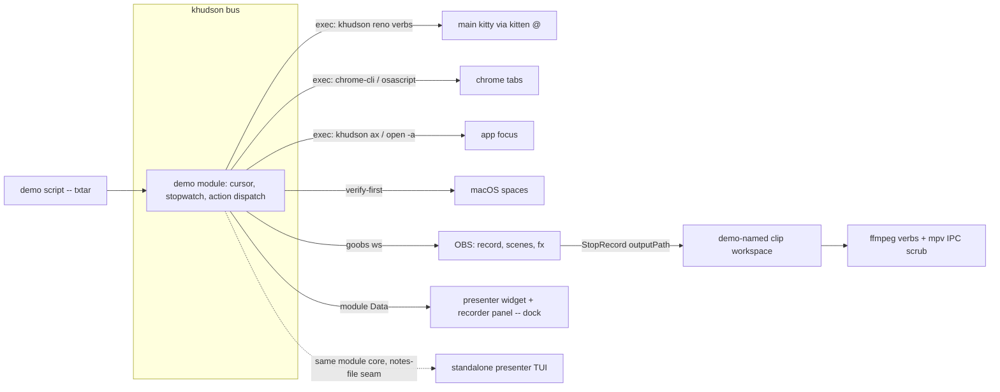

# reno -- khudson demo presenter / recorder (design)

status: proposed. Produced by a 94-agent prior-art run (28 claims 3-skeptic quorum-verified; codex leg down) and a 81-agent design review (codex up; the first cut failed on two fatals, all 16 confirmed findings are folded in below; 38 low-tier findings sat over the verify cap and remain unverified -- re-review before implementation). Annotation rounds 1-2 folded 2026-07-22: script format flipped CUE -> txtar/testscript; presenter/recorder became dedicated layouts behind one strip tab; OBS accepted as sole capture engine; component named reno end to end; moviemaker ships both surfaces over one core. No open user gates remain -- the four verify-first spikes are the remaining gates. [V] = quorum-verified, [U] = cited-unverified; load-bearing [U] items appear in the verify-first gates. The demo-presenter-recorder-register memory (2026-07-22) is the authoritative requirement set; this doc must not silently narrow it. Companions: standalone-modules-design.md (couch doctrine), magicbus-design.md (daemon fabric), overlay-subsystem-design.md (dock modal vocabulary).

## the two use cases, one spine

- live presenter: speaker notes per step, scripted machine transitions (focus kitty session a -> chrome slides tab -> kitty session b, space switches), elapsed + per-step timers with over-limit color.
- recorder: everything above optionally, plus an OBS transport panel (record/scenes/webcam FX), multi-display capture, and ffmpeg post (trim/stitch/audio) over demo-named clip workspaces.
- ad hoc recording (registered 2026-07-22): press record, drive the screen entirely manually, look at the result -- no script, or a static-notes-only one. The recorder surface, run tracking, and clip workspace work scriptless; a script is one way to drive a run, not a precondition.

The spine is the demo script file: one file per demo -- name, steps, recording config; a run yields a tracked demo name that keys the clip workspace. No surveyed format (demo-magic, doitlive, presenterm, asciicast, VHS tape, adv-ss macros) co-locates {note, budget, actions} per step, and none has per-step targets or time budgets [V] -- the format is specified from scratch as a txtar archive with testscript-style step commands (see the format section), not a pdfpc-style spec-less sidecar [U].

## decomposition (standalone-modules doctrine: composable core, thin clients)

## the engine is a native module

Native (not exec/scrape); cross-poll state for the step cursor is legal [V]. P0 is not module-only work: it also carries bus protocol changes (effect transitions, run lifecycle, subprocess ownership) and dock rendering (wrapping, heat, paging) -- the two normative sections and the widget section below.

- essential: load shedding exempts only native polls marked essential; exec scrapes always shed [V]. Demos run exactly when the machine is loaded, so the module implements Essential().
- 1s poll floor (250ms scheduler tick) [V]: budget color flips at 1Hz suffice; sub-second animation is dock-side render state.
- the component is **reno**, end to end (user, 2026-07-22): module + schema name, the strip tab, the CLI verb family (`khudson reno ...`), the script (a reno script). One registry entry + #Module vocabulary extension [V]; `demo-mode` (the unrelated renderer showcase) keeps its name.
- rejected alternative: dialing khudson.sock as a peer over TypeForward/TypeAction (protocol-declared and bus-handled, but no live producer today [V]) buys nothing until a couch client needs it.

## effectful act transitions (normative, as built + re-review reconciled)

One tap on "next" must move the cursor (in-process) and fire that step's machine actions (exec). The old contract could not express that: `HandleAct(argv) bool` is handled/not, and the bus either repolls-and-returns or execs the original argv, never both. The shipped shape (P0, 2026-07-22):

- `module.EffectHandler`: `HandleActEffects(argv) (handled bool, effects []Effect)` beside the untouched ActHandler; `Effect{Key, Argv}` -- the key, not the argv, is the retap identity, because consecutive steps legitimately repeat identical argvs. Keys are run/step/VISIT/act: re-entering a step (prev, goto) is a fresh visit that re-fires; only true replays of one transition debounce (2s window, drops loud).
- a bus-owned ORDERED executor (internal/bus/effects.go): one worker goroutine, FIFO chains, in-chain sequential waits -- a step's launch completes before its focus resolves and fast transitions never interleave. Failures are per-effect loud (TypeNotice + ActFail + events journal) and do not stop the chain's remainder. Bounded queue, loud overflow: the input worker never stalls behind a wedged effect.
- the dispatch site enforces its own structural argv gate (`khudson reno <verb>`, argv[0] bare khudson or absolute khudson path): the re-review killed the first cut's "vetted startArgv path" line -- startArgv vets nothing, so the executor gate + the script vet + the closed command registry ARE the trust chain, and the executor is not a second wire-reachable exec route.
- effects run under Setpgid with cancel-on-clean-shutdown (SIGTERM, grace, SIGKILL). The SIGKILL-bus orphan window is accepted and BOUNDED rather than pidfile-reaped: every reno verb self-terminates (kitten 10s sub-deadlines + a 30s whole-verb deadline).
- double-fire protection is module-side: a 400ms transitionGap swallows a lagging-panel retap before the cursor moves, which also collapses duplicate acts when multiple docks resolve one physical gesture (dock-dev attached beside the glass is a real state on this machine).
- tap transport (accepted delta from the re-review's ack-protocol ask): dock send failures land loudly on the status line, bus queue drops log + notice, cursor truth repaints at 1s, and a visibly-dead tap is retapped -- gap-idempotent, fresh-visit beyond. Full request-id/ack machinery is a recorded P1+ decision, taken only on stage evidence.
- why exec at all, rather than module-internal calls: the tap itself is in-process (dock -> bus -> module transition); only the machine action runs as a subprocess. That buys hang isolation, per-verb TCC identity routing (focus-app publishes os.Executable(); socket verbs stay bare khudson), a process boundary for the confirmation events to journal, and the same verbs stay drivable from a shell or a couch client with no dock running.

Costs: the module contract stops being effect-free; the bus owns an effect worker and child lifecycles; shutdown slows by the kill grace; ordered execution serializes fast navigation behind a slow step action.

## demo run lifecycle (normative)

Native modules get only static widget params, reload rereads the fixed bus ConfigPath, and #Action extension covers none of this -- script loading needs its own path:

- `khudson reno load <script> | start | stop | status | next | prev | goto <id>` -> bus ctl (proto.Msg.Args) -> module control seam; CLI-driven transitions return their effects to the bus, which execs them through the same ordered executor as tapped acts -- one dispatch site. load vets the script (txtar parse + command registry, loud errors) and stages it; start stamps a run id and ARMS at cursor -1 (arming acts on nothing; the first advance enters step 0 and starts the show clock) and REFUSES if the journal cannot land; stop finalizes.
- run journal in the state root (`reno/runs/<run-id>.json`): script path + hash, run id, cursor, per-step visits + actuals, recording state (P1). Journal ordering is settled (re-review): cursor mutation and journal write commit together under the module lock BEFORE any effect starts, and recovery is RECONCILE, NOT REPLAY -- a recovered run restores cursor/timers/staged script and never re-fires effects. Reload keeps module instances, so the script-hash check resets stale cursors; a hash mismatch on recovery restores the run as stalled with a loud status row, never a silent resume.
- one run at a time; load-while-running requires stop or an explicit --replace; staging is atomic (vet fully before swapping).
- ad hoc runs (no script): `khudson reno record` -- or the recorder-tab record tap with nothing loaded -- starts a run with no staged script under the reserved name `adhoc`, default recording config, and the same journal/run-id/workspace machinery (`<workspace-root>/adhoc/<run-id>/`). Everything downstream of run start (journal, recording state recovery, clip workspace, post verbs) is script-agnostic by construction; the presenter view just has no steps to show (a static-notes-only script is the degenerate scripted case).

Costs: a new public control surface and persistent run state on the bus.

## action dispatchers

**kitty (P0).** kitty-sessions does not use the raw rc.Client; it execs `kitten @ --to unix:main-kitty.sock ls` [V]. The three-socket firewall stands: rc.Client is substrate-only, main-kitty.sock is reachable only via exec'd kitten @ with a sanctioned verb surface of exactly ls / focus-window / launch, and text/key injection is refused at config-vet and runtime [V]. Demo steps ship as a CLI wrapper (`khudson reno focus-session <handle>`, ...) with the claudeverb confirmation discipline: fresh ls before every act (never trust poll-time ids), resolution rooted in user vars planted at `launch --var` (survives shell title rewrites [V]), revalidate-at-exec. That is the kitty-sessions seam today; extending rc.Client to dial main-kitty is a separate decision this design does not take. Focus steps must not set no_response (a zero-match still exits success with it) [V]; `launch --keep-focus` pre-stages windows without stealing focus [U]. All kitty claims pin to v0.47.4; no flake check guards drift [V].

- confirmation events: the claudeverb log cannot back wait guards as-is -- writes fail silently, ls runs only before the act, "ok" records kitten exit status with no post-action read, and lines carry no run/step ids, so stale runs would satisfy naive waits. Demo verbs emit correlated structured events (run id + step ordinal + action index) with a post-action ls, and fail loudly on journal-write failure. Costs I/O and latency per step.
- TCC identity: claude rows publish bare `khudson`, safe only because those verbs are socket-driven kitten @ with no TCC surface. AX-touching verbs must publish os.Executable() argv[0] (the dockmirror pattern) so the child runs under the granted fixed-path identity. kitty/OBS verbs may resolve via PATH; app-focus/AX verbs must not.
- handle uniqueness: FindWindowByUserVar returns the first match and launch enforces no var uniqueness, so a failed re-stage makes a handle ambiguous. Resolution rejects duplicate handles with a loud error naming both windows.
- no state overlap with dockmirror: it mirrors macOS apps (lsappinfo/AX), not kitty windows. The kitty-window peers are kittysessions (display-only rows) and this resolver, and they deliberately share nothing at poll time -- resolution is a fresh ls at exec.

**app focus (P0).** `open -a` / NSRunningApplication appear in no TCC service list [U]; Sonoma made activation cooperative (a background HUD activating third apps can get refusals and bouncing Dock icons), so pair activate with an AX raise under the existing Accessibility grant. The existing `khudson ax` code is not general app focus -- the only raise in the tree is the unminimize fallback (exact-title, minimized-only, Space-blind: kAXWindows omits other-Space windows). A demo `ax focus` verb is a new AX subsystem: bundle-id resolution, window selection policy, post-condition verification, and a stated interaction with the deferred Spaces decision. Budget it as new work, not reuse.

**chrome tabs (P2).** CDP is reportedly dead on the daily profile since Chrome 136 (remote-debugging-port ignored without a custom user-data-dir) [U, gate 3]. Path of record: chrome-cli (`activate -t <win>:<tab>`, stable ids, Scripting Bridge over the same sdef) or direct AppleScript `set active tab index` [U]; either needs one Automation (AppleEvents) pair-grant, and the grant lands on the responsible process -- exec'ing osascript from under kitty attributes the grant to kitty; disclaim responsibility or route through the khudson binary [U]. Hammerspoon was considered and rejected here too: a resident Lua daemon holding its own Automation/AX grants, for capability chrome-cli/osascript already provide (and its spaces module already fell as experimental).

**window visibility, not spaces (DECIDED, user 2026-07-22).** No yabai, no Spaces switching, no CGEvent synthesis -- the reframe is the decision, not a leaning: demo steps express "make the right windows visible" as hide/unhide + focus verbs (app hide via AX/AppleEvent, unminimize, the shipped focus-app raise), never desktop switching. Cross-space windows stay out of scope by construction (kAXWindows is Space-blind and the verbs say so loudly). Former gate 4 (yabai SIP posture) is closed unspiked; the P2 dispatcher work is a `hide-app`/`show-app` verb pair on the existing ax plumbing.

**OBS (P1+).** One goobs connection (the only maintained v5 Go client; pin it -- conformance-tracked to obs-websocket 5.7.4) [U]. Capability-probe at connect via GetVersion.availableRequests rather than assuming doc parity [U]. Record lifecycle: StartRecord/StopRecord/ToggleRecordPause; StopRecord returns outputPath -- the synchronous handoff into post, no filesystem watching [U]. GetRecordStatus feeds the HUD recording timer. One ScreenCaptureKit source binds one display, so multi-display demos are scene-per-display switched via SetCurrentProgramScene; UUID addressing makes scripts rename-proof (filters stay name-addressed) [U]. Prefer display/application capture over window capture (SCK window quirk history) [U].

**webcam FX (P3).** All of it is plain obs-websocket against a local recording -- no camera extension, no approval, nothing shared with the scrapped vcam leg below. Instant move/scale-huge: stock SetSceneItemTransform; visibility: SetSceneItemEnabled -- no plugin [U]. Eased motion (the bounce): pre-authored exeldro Move filters fired remotely via SetSourceFilterEnabled [U]; pixelate via composite-blur, parameters ordinary filter settings [U]. Fully dynamic paths: SerialFrame RequestBatch with Sleep pseudo-requests, frame-locked in OBS [U]. Advanced Scene Switcher's vendor API would move demo logic into OBS's scene-collection store, where it is stripped if the plugin is absent -- rejected; the script file stays authoritative and OBS is an actuator only [U]. Plugin dependency is the live risk, not vcam: Move and composite-blur move fast and nix owns neither of them here (see "what gets worse"), so the connect-time capability probe is the only guard and the plugin-free subset is the default.

**virtual cam / gmeet: SCRAPPED (user 2026-08-10).** Cut entirely, not deferred: no phase, no gates, no code. reno records locally and the FX vocabulary above needs none of it. Ledgered so it never gets re-researched:

- the mechanism: OBS virtual cam is a CMIO camera extension (OBS 30+/macOS 13+) behind a one-time system-extension approval MDM can block outright [U]. Live-observed 2026-07-23: OBS 32.2 refuses to install the extension unless the app sits in /Applications, and the cask lands in ~/Applications here -- so any revival needs the install moved or the cask appdir changed BEFORE the approval is even offered.
- the dead use case: terminal-as-camera into Meet. A normal camera tile's quality ceiling makes terminal text illegible; the only viable target was Meet's "present content from camera" (2025), a camera device as the presentation tile at up to 1080p30, Workspace-edition-gated [U].
- operational pins if it ever revives: OBS output 1920x1080 NV12 (I420 + full range renders black downstream), start the vcam before joining, and disable macOS Reactions per-app for it (default-on -- a hand gesture fires fireworks over the demo) [U].
- zero-approval ways to get a composed scene into a call, if that need returns: OBS fullscreen projector as an ordinary shareable window (no extension, no browser), or render the scene in a browser page and present-a-tab [U]. Both are screen-share shaped, not camera shaped.
- adjacent leads NOT pursued, recorded only: (a) a composited personal camera feed for all calls (face + framing/blur/lower-third) -- the one vcam use with real standing value, same extension gate, and a khudson concern only if the overlay is khudson-drawn; (b) a virtual display as a fixed demo canvas (BetterDisplay already on this machine) so recording geometry stops depending on the physical arrangement -- no TCC surface, not vcam at all, and it interacts with the hud-launcher's position-staleness relaunch. Snapshotted separately in virtual-canvas-design.md (2026-08-10): reno needs no display-selection changes for it, the real blocker is that no verb places a window on a display, and the whole idea is downstream of one probe (do BetterDisplay virtual screens enumerate in CGGetActiveDisplayList).

**post (P4).** Clips from one OBS profile are homogeneous, so the concat demuxer stays lossless; the ffconcat list's per-file duration/inpoint/outpoint expresses trim+stitch of N takes in one invocation, with the standard keyframe caveat (copy snaps to keyframes; re-encode per clip for exact cuts -- LosslessCut's smart-cut is unreliable, don't build on it) [U]. Audio drop/replace (`-an`, `-map 0:v -map 1:a -c:v copy`) is pure remux [U]. Scrub/review: mpv JSON IPC over a unix socket (ndjson seek/frame-step/time-pos, no cgo) [U]; LosslessCut stays the manual escape hatch. CLI verbs first (`khudson reno trim|stitch|mute ...`); then the moviemaker core grows BOTH surfaces -- a touch view behind the reno tab and a main-display app -- as thin clients of one core, the standalone-modules shape (annotation round 2: "why not both? should just be a matter of layout and code structure" -- it is, given the core/client split).

## ad hoc expansion (registered 2026-07-23, next arc after the P0-P2/P4 landing)

The register's 07-23 batch, designed against the installed OBS 32.2.0
(~/Applications/OBS.app, homebrew cask, never launched). Ground truth
below was pulled from the installed binaries, not docs: obs-websocket
5.x persists {server_enabled, server_port, server_password,
auth_required, first_load} in plugin_config/obs-websocket/config.json;
the CLI flags are exactly --websocket_port / --websocket_password /
--websocket_debug -- overrides only, NO enable flag -- so seeding
config.json is the one mechanism that turns the server on. OBS core
reads global.ini + user.ini; user.ini [General] FirstRun gates the
first-run wizard.

**khudson-managed obs-websocket (kills the manual enable step).**
`EnsureOBS`: dial; if down, seed config.json (server on, port 4455,
auth on with a generated password written to <state>/reno/obs-password
0600 -- ObsPassword() already reads it), seed user.ini FirstRun=true
ONLY when user.ini is absent, assert khudson's named ini keys (below),
refuse loudly if an OBS process is already running with the socket down
(websocket config binds at launch; quit and re-run), else launch via
`open -g -a` and poll-dial to a deadline. Only record / obs ensure /
obs probe may launch OBS (120s watchdog); stop/pause/resume/scene stay
dial-only under the 30s watchdog -- stopping a recording must never
boot OBS. Accepted one-times on first launch: Screen Recording +
Microphone TCC prompts on first source creation. Quarantine
(live-verified 2026-07-23): on this MDM'd machine the cask-quarantined
app NEVER gets a Gatekeeper approval dialog -- exec wedges in
_dyld_start indefinitely, foreground or background -- so first launch
is user-gated: approve by hand (right-click Open / System Settings) or
strip the xattr; khudson itself does not strip xattrs, and Ensure's
timeout error names the hazard.

**ini seeding, for the settings the socket cannot reach (2026-08-21).**
obs-websocket has no global-config request at all, so the user.ini
window posture is unreachable over the wire; and while
SetProfileParameter does write basic.ini immediately, the RUNNING
instance keeps the output it already built -- flipping RecEncoder live
left StartRecord reporting success with no output started, no file, and
an OBS dialog raised (canvas/fps are the exception: SetVideoSettings
resets the video pipeline live). Encoder, container, and quality
therefore have to be on disk BEFORE launch. `seedIni` asserts a named
key list into user.ini ([BasicWindow] SysTray{Enabled,WhenStarted,
MinimizeToTray}, the three WarnBeforeStart/Stop keys, [General]
ConfirmOnExit=false) and into the active profile's basic.ini
([SimpleOutput] RecQuality=HQ -- the stock "Stream" quality inherits the
6000 kbps stream bitrate, starvation for a 4K capture). It edits keys in
place and leaves everything it does not name alone, so a real user
config survives; and it runs ONLY against a stopped OBS, because a live
instance holds the config in memory and writes its own copy on exit --
an edit behind its back is reverted, not ignored, which is worse than
not writing at all. RecEncoder stays deliberately absent until a
cold-boot launch-and-record proves the VideoToolbox switch.

**RecordConfig, one core for every surface.** A recording config
{screens (display + optional region), audio (device | none), webcam
preset} with exactly three producers: script headers
(`screen <sel> [x,y,WxH]` repeatable, `audio <device|none>`,
`webcam <off|br|tr|bl|tl|big>`, all record-gated like scene), the
ctl seam (`record-config`, driven by `khudson reno config` flags), and
recorder-view menu taps (in-process acts mutating the module's desired
config). Arm snapshots the config into RecordingState write-ahead; the
record verb is one consumer. EMPTY config = OBS untouched
(today's behavior, scene header still honored); ANY knob set = the
verb ensures the khudson-owned scene "reno" matches the config and
switches to it. The scene plan (desired inputs, transforms, crops,
mutes) is computed PURE in internal/reno from the probed environment
(monitors, canvas, input kinds, device items) and unit-tested; the
verb executes it through the extended ObsTransport. Display/device
selection resolves by index/UID or unique name substring at apply
time, loud on zero or ambiguous (the handle discipline). audio none
mutes every audio input reno does not own -- legal because this OBS
instance is khudson-managed by decision; a user OBS config is exactly
the empty-config path.

**The pad is a mixer, not a form (2026-08-21).** The ad hoc config is
DESIRED state, not a queued submission: every knob that moves -- tile
tap or `khudson reno config` alike, one core -- drives the reno scene
right then via `khudson reno obs apply`, and the head row reads back
what the apply did ("applying...", the summary, or the error). Arm-time
apply survives as a convergence check rather than first contact.
Mechanics: at most ONE apply is in flight (each is a full OBS probe, so
a tap-per-apply fan-out would wedge the socket); a change landing during
one sets a dirty latch and the completing apply re-emits, capping a
hammered pad at two applies; a 30s wedge bound releases the latch if a
note never lands (killed child, bus restart mid-apply). The verb reads
the config over ctl at exec time, not from argv, so queued taps are
already folded in -- that is what makes the latch converge. `apply`
dials only, never launches: a stray tile must not cold-launch OBS
(record/ensure/probe keep that right), and OBS-down notes ok ("cold,
held for the next record") because between takes that is the ordinary
state, not a fault. The posture persists to <state>/reno/config.json
and recovers on bus start WITHOUT re-applying -- a boot must not reach
out and mutate a scene nobody asked it to touch.

Two glass consequences: the mic band's old "obs as-is" is now "no mic"
against "mute all" (both silence reno's mic; they differ in whether the
REST of OBS goes quiet -- a scope difference, so the labels name scope
instead of a mechanism nobody can see), and the cam band drops its
as-is tile entirely, since unset and "off" both end with a dead
reno-cam and only "off" leaves it staged for an instant later preset.

**Probe + inventory.** `khudson reno obs probe` ensures OBS, ensures
the reno-mic/reno-cam skeleton inputs (created disabled, kind picked
from GetInputKindList: screen_capture over display_capture,
macos-avcapture over av_capture_input), enumerates devices, and notes
the inventory into the module over ctl (`obs-inventory`). Mic/cam
device items enumerate via GetInputPropertiesListPropertyItems
(device_id / device, first non-empty wins; nameless entries dropped --
the cam list leads with one). DISPLAYS DO NOT: enumerating the SCK
source's display_uuid property SEGVs obs-websocket in OBS 32.2
(strlen(NULL); crash-verified 2026-07-23, three .ips reports), so
displays enumerate locally via CoreGraphics (internal/cgdisplay:
CGGetActiveDisplayList + CGDisplayCreateUUIDFromDisplayID -- khudson
always runs on the machine OBS captures, and local CG also supplies
the pixel-space geometry the crop fallback needs). The recorder view
renders its screens/audio/webcam menus from the stored inventory; a
missing or stale inventory renders a "probe obs" act row instead of
dead menus. The module still never dials OBS. Live-verified end to end
2026-07-23 (TestObsLiveOrchestration): ensure -> probe -> scene build
(display capture + audio-none mute sweep) -> record -> stop -> real
clip in the run workspace; StopRecord's output file finalizes
asynchronously, so consumers poll for the flush.

**Webcam for ad hoc (P3 subset).** Enable + placement presets only
(off, corner PiP x4, big) via SetSceneItemEnabled +
SetSceneItemTransform bounds -- no plugins, no eased motion; the P3
FX vocabulary is untouched.

**Ad hoc notes.** `khudson reno notes <file.md> | --clear` over ctl:
the module stores the resolved text (absolute path, read at load,
loud errors) and the presenter renders it whenever no staged script
claims the view -- idle or mid ad hoc run. A static-notes-only script
remains the richer path; this is the zero-ceremony one.

**Swipe swaps strip tabs (single-finger).** Multi-finger is
hardware-refuted (panel firmware is single-contact); the recognizer's
Swipe(dir) already fires live. The dock routes horizontal swipes to
strip-tab cycling over the ring [home, entries...] (Alt pairs count
as one slot, "soon" stubs skipped); swipe left = next tab, right =
prev. Scope: an open overlay swallows swipes (the menu owns the
glass), and future drag/wheel consumers opt their regions out via the
hit table before forwarding lands. Vertical swipes stay unbound.

## demo script format (txtar + testscript-style commands)

Decision (annotation round, 2026-07-22): a txtar archive per demo. The comment section carries the step script as testscript-style command lines; file sections carry the speaker notes as real markdown, with external file references allowed for shared material. This supersedes the first cut's CUE lean on the axis that matters most -- notes are the bulk of a script and author as plain markdown instead of multiline strings -- and the command shape maps 1:1 onto the engine's dispatcher registry (the go-internal testscript pattern: features wired as registered commands). We reuse the format and the registry pattern, not the test runner: the engine implements its own stepper over the parsed archive. What CUE would have bought and this gives up: a declarative constraint language and vet symmetry with edge.cue; the replacement is `khudson reno vet` -- parse the archive, resolve note refs, check every command against the registry (unknown command or arity = loud error), pin the name slug and workspace containment. A nix check vets committed scripts; ad-hoc scripts vet at load. Syntax below is illustrative; it settles in the P0 spec.

Step shape: a `step` directive opens a step; `note <file.md>` binds its notes; `budget 90s` its time budget; the remaining lines are commands. Semantics taken from the survey [V]:

- wait guards (VHS `Wait +Screen /regex/`): a readiness condition gating advance instead of fixed sleeps, expressed against the demo verbs' confirmation events -- not substrate scraping.
- capture gates (VHS Hide/Show): per-step off-camera flag driving OBS record-pause/resume.
- markers as steps (asciicast `m` + label): human-gated advance over a linear timeline is the base interaction; touch next/prev is the pause-on-markers pattern.
- note fragments per action (Slidev [click]): a step's note file may carry fragment markers that segment against its commands.
- commands are engine-registered (focus-session, chrome-tab, space, obs-scene, obs-record, obs-fx, wait, ...): the vocabulary is closed by construction, and the global #Action schema is untouched -- the demo tool owns its script surface end to end (parsing, registry, its own UI), per the annotation that this is tool-internal detail, not a config-vocabulary change.
- archive header: `demo <name>` plus optional total budget and recording config (scenes, targets, workspace).
- workspace identity (enforced by vet from P0 even though recording is P1): the name is regex-pinned like widget ids (`^[a-z][a-z0-9-]*$`), each run writes to `<workspace-root>/<name>/<run-id>/` so retakes never mix, and containment is vetted (no absolute or traversal escapes from a script file).

## timers

One engine-owned stopwatch, N read-outs: bubbles timer stops dead at zero and cannot render overtime; stopwatch plus per-step diffs at boundaries is the shape, and it is O(1)-tick [U]. Display: stagetimer-style green/yellow/red thresholds on the per-step budget, pdfpc-style negative counting in loud red past zero [U]. Per-step budgets and cumulative pace together in a terminal has no prior art -- ship per-step first, add reveal.js-style whole-talk pacing later if wanted. A rehearse/calibration mode (record actual step durations to seed budgets) is a later maybe. Colors are data (heat vocabulary); 1Hz flips fit the poll floor.

## presenter widget + recorder panel (dock)

- presenter: current step title + note body, next-step preview, elapsed + step chips, big tap targets for next/prev (tap-only-safe: no holds, no chords, no drags [V]), long-press overlay menu for goto/abort/record toggles.
- notes rendering: rows render one line each and Poll never learns region dimensions, so prose notes need a wrapping path. Decision: a dock-side chrome renderer for the presenter region (the resources-card precedent) wraps note text to the region rect; the module publishes text, the dock owns geometry. Rendering becomes size-dependent -- goldens per width bucket.
- timer heat: the row style vocabulary is exactly dim/accent/warn/highlight; green/yellow/red exists only in gauges/sparks. Timer chips ship as a semantic budget-fraction field (PctHeat-style) rendered through the existing heat ramp by the chrome renderer -- never raw colors from the module.
- goto paging: popovers keep only rows that fit and discard the rest (under ~22 reachable steps on this glass), so the goto menu renders windowed around the cursor with paging taps, not the full script.
- placement (annotation round, 2026-07-22): presenter and recorder are two dedicated layouts behind ONE strip tab, "reno", flipping between the views at the tab -- the strip-flip precedent -- not home-region tenants. Region geometry is peeled from the static config list before data renders, so this also answers "shown only when the script declares recording" structurally: the recorder view is offered when the loaded script declares recording config OR when no script is loaded (the ad hoc path -- record must be one tap from the tab with nothing staged); only a loaded script that declares no recording hides it. The home layout is untouched.
- recorder view: transport state from GetRecordStatus/events, scene picker, FX one-shots, last-clip verbs.
- couch: the module core is dock-agnostic; the simplest cross-process notes seam is patat's notes-file-as-bus (rewrite a notes file per step; any client watches it) [U], with presenterm's UDP publish/listen as the richer two-process pattern [U]. Scheduling rides standalone-modules, not this doc.

## P1 preconditions (recorded now, land with their phase; extended by the 2026-07-22 re-review)

- module lifecycle hooks: modules are Name+Poll only and shutdown waits scheduler+caffeinate+effects only, so a persistent goobs connection either dies every poll or leaks across shutdown/reload. P1 adds optional Start/Close hooks to the module contract before the OBS client lands -- WITH a defined lifecycle manager (re-review finding 10): who starts hooks (start-configured, not start-all -- OBS must not connect on a reno-less config), the startup-failure policy, and reload transitions, specified before the first hook is written.
- stale-on-error vs record controls: failed polls keep the previous act allowlist and native data carries no timestamp -- after an OBS disconnect, stale record/scene acts stay authorized and look healthy. The demo surface gets explicit disabled/stale states (scoped; global stale semantics unchanged).
- recording identity + two-phase ingest (re-review finding 5): a journal boolean cannot prove the current OBS recording belongs to this run. P1 journals recording INTENT + start identity + expected output metadata write-ahead of StartRecord, and recovery ingests clips two-phase (quarantine until identity checks out) instead of auto-attaching to whatever OBS is doing; some recoveries become deliberately manual.
- OBS referent revalidation (re-review finding 9): `reno vet` stays syntactic, so P1 adds a load-time referent pass against the running OBS (scene UUIDs/names resolved, missing referents loud) exposed as `reno vet --live`; committed-script CI vetting and live vetting diverge by design. The same preflight grows the environment half (round-2 M6): kitty version vs the rc.go pin, main-kitty socket liveness, script handles resolvable -- showtime surprises become load-time refusals.
- clip workspace retention (round-2 M7): the boot sweep extends to `<state>/reno/workspace/<demo>/<run-id>/` dirs whose run journal is finalized past the horizon, with an explicit keep-mark for archived demos; one-shot boot work per the constant-cost invariant.

## what gets worse

- a new always-on surface on the existing bus (module + ctl verbs + reno CLI wrapper) that must idle at zero cost.
- CORRECTED 2026-08-10: OBS and its plugins do NOT ride nix, and cannot on this platform -- nixpkgs obs-studio is linux-only, so OBS is an unversioned homebrew cask (darwin.nix:107) that self-updates into ~/Applications, and no plugin is installed at all (neither obs-studio/plugins dir exists). The earlier "pin churn accepted" line assumed an ownership that never existed here. Consequence for P3: the plugin-free FX subset (SetSceneItemTransform, SetSceneItemEnabled, SerialFrame batches) is the only part with no unowned dependency; eased motion via Move and pixelate via composite-blur would be hand-installed plugins under a self-updating cask, with the connect-time capability probe as the sole defense. Prefer the plugin-free subset; treat Move/composite-blur as an explicit opt-in with a "plugin absent" degraded path, not an assumed dependency.
- effectful commands now execute from script files. They stay demo-tool-internal (engine registry, no global #Action change), so the growth is contained to the demo module's own surface; the one global seam is the effect executor pushing vetted argvs through startArgv.
- one more strip tab and two new layouts to maintain; the home layout budget is untouched (the rail-width claw-back stays banked).
- the kitty 0.47.4 pin becomes load-bearing for demo verbs too; still no drift check (existing debt, weight increases).

## verify-first gates (before their phases) -- ALL FOUR CLOSED as of 2026-08-10 (1-2 scrapped, 3 resolved, 4 retired); nothing external gates any remaining phase

1. SCRAPPED (user 2026-08-10): MDM camera-extension approval -- gated vcam, which is cut. Numbering held so gate 3/4 references elsewhere stay valid.
2. SCRAPPED (user 2026-08-10): Meet "present content from camera" availability -- same cut.
3. CDP-on-daily-profile death on the installed Chrome version (decides the P2 chrome dispatcher) -- RESOLVED 2026-07-22: Chrome 150 installed, well past the 136 cutoff, and chrome-cli is unpackaged in nixpkgs; dispatcher = osascript AppleScript direct.
4. RETIRED (user 2026-07-22): no spaces machinery at all -- window hide/show/focus verbs instead; nothing to spike.

## phasing (each deployable alone; LANDED marks 2026-07-22 arc state)

1. P0 script + presenter: LANDED (commits ab25171 + 2448fc5). txtar format + `khudson reno vet`, EffectHandler + ordered effect executor, run lifecycle + journal, kitty focus/launch verbs + ax focus-app + open-url, reno strip tab (alt-pair flip) + presenter renderer + recorder shell.
2. P1 OBS transport: LANDED (code + seams; LIVE VERIFICATION OWED -- OBS arrives as a cask on the next switch, then enable its websocket server and run khudson-live). goobs per-verb connections (capability-probed), record/scene script vocabulary, write-ahead recording intent + identity notes in the journal, ad hoc scriptless runs (`khudson reno record` + the recorder view's one-tap record), module.Closer.
3. P2 chrome + window visibility: LANDED (same live-verification caveat for the Automation grant). chrome-tab via osascript (gate 3: Chrome 150, chrome-cli unpackaged); hide-app/show-app on kAXHidden + the focus raise (spaces retired, user 2026-07-22).
4. P3 webcam FX: NOT STARTED, and UNGATED as of 2026-08-10 -- the gmeet/vcam half is scrapped (see the capture section's ledger), and what remains is obs-websocket transform/filter work with no external approval in front of it. Already landed is placement only (WebcamPresets + CamTransform, internal/reno/scene.go); the motion/pixelate/dynamic-path vocabulary is unbuilt.
5. P4 post: clip verbs LANDED (`khudson reno trim|stitch|mute|dub`, copy-fast + --exact re-encode; ffmpeg/mpv ride home.packages). OWED: mpv-IPC scrub surface + the moviemaker surfaces (reno-tab touch view + main-display app over one core).
6. couch client: NOT STARTED -- standalone presenter TUI over the module core (notes-file seam first).
7. ad hoc expansion (2026-07-23 register): LANDED + LIVE-VERIFIED same day. ObsBoot (seed websocket config + generated password + launch, Ensure short-circuits on a live socket), RecordConfig one-core (script headers screen/audio/webcam == `khudson reno config` == recorder-view menus), scene plan pure in internal/reno + thin executor, local CG display enumeration (internal/cgdisplay, the obs-websocket SEGV workaround), probe/inventory ctl, ad hoc notes (`khudson reno notes`), webcam presets, single-finger swipe tab cycling in the dock. OWED: glass-side eyes-on (swipe + recorder menus render after the next switch + bus/HUD restart); OBS first launch was user-approved by hand (quarantine dialog never fires on this MDM posture -- see the boot section).

8. live-apply mixer (2026-08-21): LANDED. Config changes drive OBS
   immediately behind a one-in-flight latch (`khudson reno obs apply`,
   `apply-begin`/`apply-note` ctl), the posture persists to
   <state>/reno/config.json across bus restarts, the head row reads the
   apply outcome, and the mic/cam bands lost their "obs as-is" tiles.
   Alongside it, ini seeding for what obs-websocket cannot reach
   (user.ini window posture, basic.ini RecQuality=HQ), stopped-OBS only.
   OWED: glass-side eyes-on after the next switch + HUD restart, and a
   cold-boot record before RecEncoder joins the seeded profile keys.

## open questions

None. All four original user gates resolved in the 2026-07-22 annotation rounds: component name = reno end to end; script format = txtar/testscript; OBS as sole capture engine, no ScreenCaptureKit/avfoundation fallback in P1 (from the round-1 thumbs-up); moviemaker home = both surfaces (reno-tab touch view + main-display app) as thin clients of one core. Remaining gates are the four verify-first spikes above.
