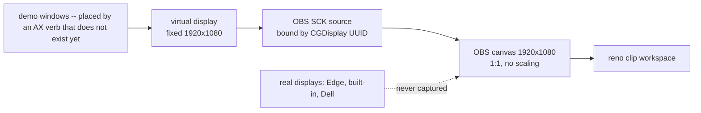

# virtual canvas -- a fixed demo/recording canvas on a virtual display (design snapshot)

Design history and intended behavior. For current process ownership, shipped
capabilities, and validation limits, see [current architecture](architecture-current.md).

status: PROPOSED, no code, nothing gated on it. Snapshot taken 2026-08-10 while scrapping reno's vcam/gmeet leg (reno-design.md capture section, adjacent lead (b)) -- captured independently so it survives outside that ledger. Claims are file:line-grounded against the tree at that date; [V] = verified here, [U] = expected but not probed.

the idea: stop recording whatever displays happen to be plugged in. create one virtual display of fixed geometry, run the demo on it, capture that. recording geometry becomes a constant instead of a function of the physical arrangement.

## why it plugs in with almost no reno code

three seams already exist and none of them distinguishes a virtual display from a physical one.

- **enumeration is generic CoreGraphics** [V]. `internal/cgdisplay` calls `CGGetActiveDisplayList` and pulls UUID + bounds + pixel size + isMain. no is-this-real check anywhere, and no TCC surface (display lists and geometry are unrestricted; the package comment says so).
- **reno selects displays by index-or-name and binds by UUID** [V]. `ScreenSel.Display` (internal/reno/scene.go:60) resolves "a 1-based monitor index or a unique name substring" against the enumerated items; the scene builder hands SCK the CGDisplay UUID. a canvas named `reno-canvas` is selectable by substring the day it exists, no reno change.
- **`Region` crops are in source pixels** [V] (`x,y,WxH`, scene.go:74). a stable canvas turns region constants from arrangement-dependent guesses into durable ones.

the sharp edge this also files off: `cgdisplay` documents that `CGDisplayBounds`/`CGDisplayPixelsWide` are in POINTS on Retina while capture sources see the display MODE's pixels (arc-2 review finding #23). a canvas at 1920x1080@1x collapses points and pixels to one number and deletes that confusion class for the capture path.

## provenance: better than OBS's

BetterDisplay is nix-owned [V] -- `betterdisplay` 4.3.4 in `home.packages` (homies/shimmerjs/darwin.nix:133), deployed at `~/Applications/Home Manager Apps/BetterDisplay.app`. contrast OBS, which is an unpinned homebrew cask because nixpkgs obs-studio is linux-only.

caveat [V]: the package is app-bundle only. no `bin/`, no `betterdisplaycli`. BetterDisplay's CLI is something the app installs into /usr/local/bin on request, i.e. outside nix. so scripted canvas creation needs that unmanaged binary or the app's URL scheme [U]; a hand-created persistent virtual screen needs neither, and is the right first cut.

## hud-launcher interaction

`LaunchPos` (internal/hudlaunch/hudlaunch.go:508) finds the primary by Cocoa origin (0,0) then computes `y = primary.H - (target.Y + target.H)` [V]. two consequences:

- creating or destroying a virtual display re-lays out global coordinates, which trips the `childMoved` relaunch (same file, healthy tick). correct behavior, but the HUD blinks -- so **create the canvas before a run, never during one**.
- if a virtual display ever became primary, the `primary.H` term changes and the Edge HUD's computed position moves with it.

## what it buys

1. **pixel-exact terminal text.** today a demo captures the built-in Retina panel (2056x1329 points) or the Dell and OBS scales it into 1920x1080 output -- every glyph resampled, thin box-drawing and small weights go mushy. that is fatal when the content of the demo IS terminal text. canvas capture is 1:1, no scaling in the chain.
2. **scripts stop lying when hardware changes.** `screen 2` or `screen DELL` means one thing at the desk and another on the couch: the index points at a different panel, or the name stops resolving and the run dies at `reno vet --live`. a canvas is present because I created it, so the selector resolves identically everywhere.
3. **real screens stop being hostage.** the demo lives on the canvas; Slack, notes, and the presenter view stay on real panels and cannot leak into the take. re-takes stop dying to a DM at second 40. probably the biggest day-to-day win.
4. **demoing khudson itself becomes composable.** the register asks for multi-screen capture specifically to demo khudson, and the Edge's 2560x720 strip is awkward to composite against a normal panel. on a fixed canvas the scene is authored once (Edge strip up top, demo terminal below, webcam PiP in a corner) with transforms that stay valid.
5. **re-takes actually stitch.** post leans on clips from one OBS profile being homogeneous to keep the concat demuxer lossless (reno-design.md post section). arrangement drift between sessions is exactly what breaks that -- desk take and couch take differ in geometry, so stitching jump-cuts in scale or forces a re-encode.

## the real blocker, and it is not BetterDisplay

nothing renders on a virtual display unless something puts windows there, and **reno has no verb that places a window on a display** [V]. the vocabulary is `focus-session`, `launch-session`, `focus-app`, `hide-app`/`show-app` (kAXHidden + focus raise), `chrome-tab` -- all raise or hide, none place. this needs an AX window-position primitive moving a window into the target display's coordinate range: khudson work in `internal/ax`, not BetterDisplay work. scope this before calling the idea cheap.

## open questions

1. **does it even enumerate.** do BetterDisplay virtual screens appear in `CGGetActiveDisplayList` with a usable UUID, and does SCK capture them? [U] -- expected (it is the whole premise of dummy displays) but not probed; no virtual display exists on this machine as of the snapshot. probe = one canvas + the existing cgdisplay path. everything else here is downstream of this answer.
2. **1x versus 2x.** 1920x1080@1x means kitty renders non-Retina on the canvas, so fonts read thinner than the Retina panels I author on. 3840x2160@2x downscaled to 1080p gives supersampled text that often looks better. which wins for TUI content is an eyes-on call on the same frame, not something to assert.
3. **who creates the canvas.** hand-made persistent virtual screen (zero new dependency, manual) vs khudson driving the app-installed CLI or URL scheme (automatable, unmanaged path outside nix). start manual; automate only if the manual step actually annoys.
4. **does the canvas want to be a khudson concept at all**, or just a display the config happens to name? leaning: just a display -- reno already addresses displays generically, and inventing a canvas abstraction buys nothing until question 1 is answered.

## phasing

1. probe question 1. if virtual screens do not enumerate or SCK will not bind them, the whole idea dies here for the cost of one experiment.
2. eyes-on question 2, pick a geometry, record it here.
3. the AX place-window verb (the actual work) + a reno step command for it.
4. only then: canvas-aware scene authoring and whatever automation question 3 justifies.
